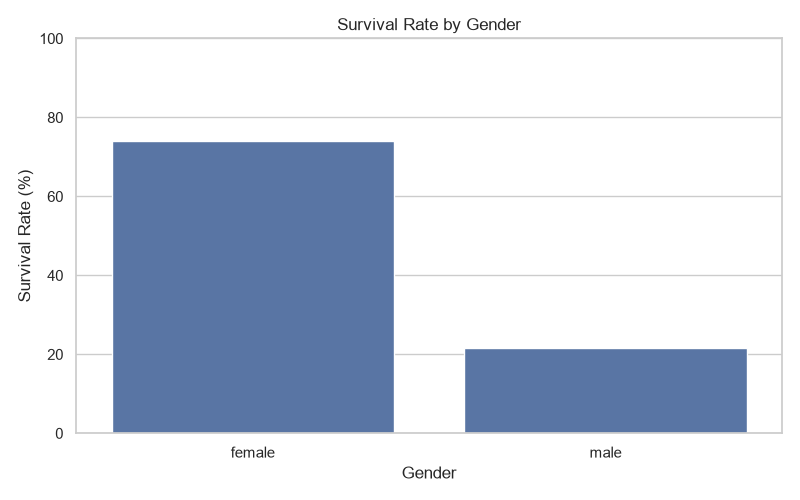
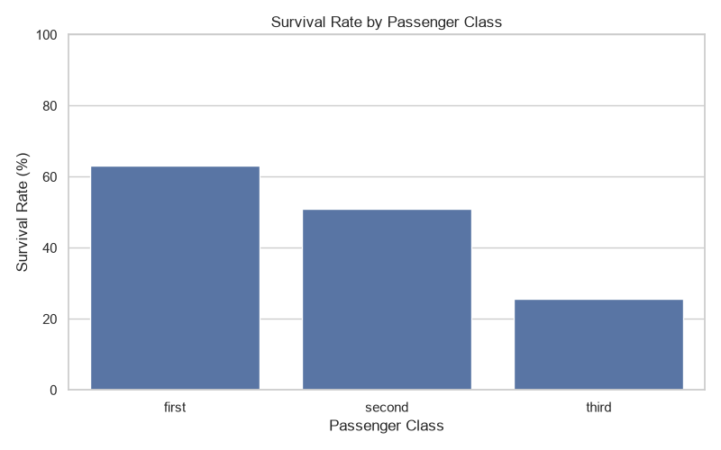
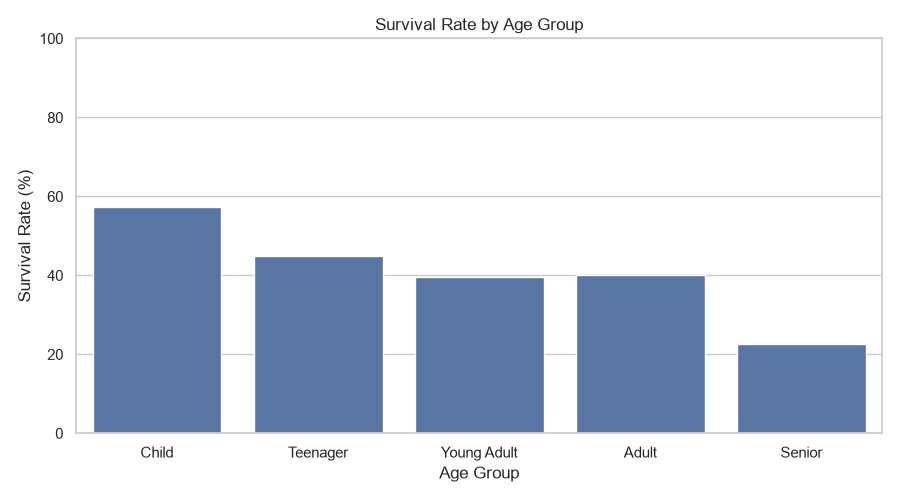
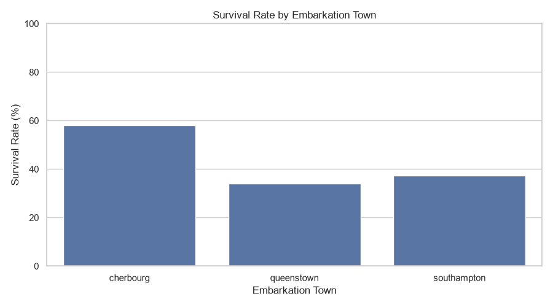

# Exploratory Data Analysis (EDA) Report
## SWYNEX Technologies – Task 2

### 1. Project Overview
This project performs Exploratory Data Analysis on the cleaned Titanic dataset using Python, Pandas, NumPy and Matplotlib.

### 2. Dataset Information
- Total Records: 784
- Total Columns: 15
- Missing Values: 0
- Duplicate Records: 0

### 3. Key Statistical Findings
- Average passenger age: 29.65 years
- Average family members (siblings/spouses): 0.52
- Average parents/children aboard: 0.42
- Overall survival rate: 41.20%
- Overall non-survival rate: 58.80%

### 4. Key Insights

**Insight 1: Gender and Survival**
- Female survival rate: 74.06%
- Male survival rate: 21.59%
- Female passengers had a significantly higher survival rate.

**Insight 2: Passenger Class**
- First Class: 63.08%
- Second Class: 50.91%
- Third Class: 25.68%
- First-class passengers had the highest survival rate.

**Insight 3: Age Group**
- Children: 57.35%
- Teenagers: 44.78%
- Young Adults: 39.54%
- Adults: 40.10%
- Seniors: 22.73%
- Children had a higher survival rate than the other age groups.

**Insight 4: Embarkation Town**
- Cherbourg: 58.06%
- Queenstown: 33.90%
- Southampton: 37.37%
- Cherbourg passengers had the highest survival rate.

**Insight 5: Overall Survival**
- 323 passengers survived.
- 461 passengers did not survive.
- The overall survival rate was 41.20%.

### 5. Data Visualizations

#### Survival by Gender

#### Survival by Passenger Class

#### Survival by Age Group

#### Survival by Embarkation Town

### 6. Tools and Technologies
- Python
- Pandas
- NumPy
- Matplotlib
- VS Code
- Git and GitHub

### 7. Conclusion
The analysis indicates that gender, passenger class, age group and embarkation town were associated with differences in Titanic passenger survival rates.

Female passengers and first-class passengers had higher observed survival rates.

This project demonstrates data analysis, statistical exploration, visualization and insight generation using Python.

---
**Project completed as part of SWYNEX Technologies Internship – Task 2.**
